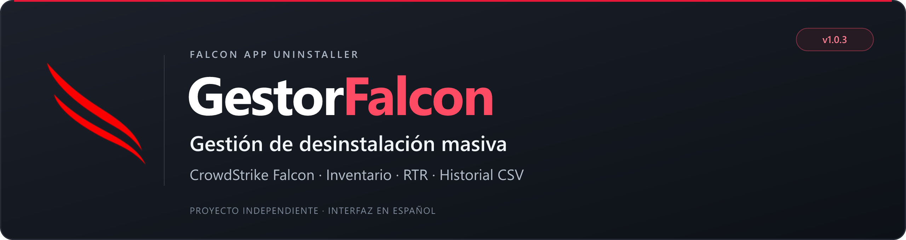
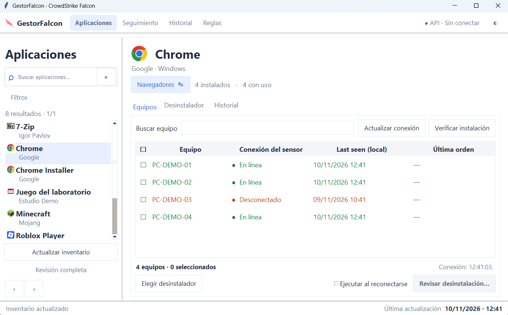
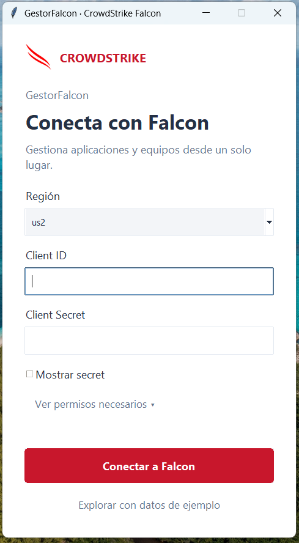
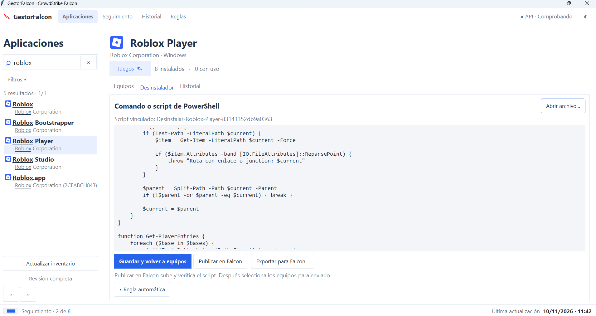
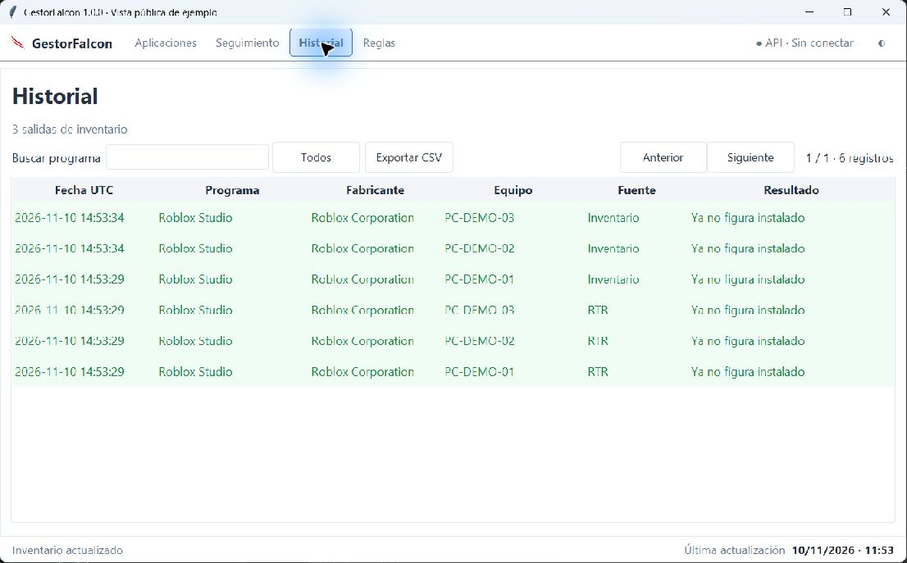

<p align="center">
  
</p>

<p align="center">
  
  
  <a href="LICENSE"></a>
  <a href="https://github.com/vicnpc202/falcon-app-uninstaller/actions/workflows/tests.yml"></a>
</p>

<p align="center">
  <a href="#instalación-rápida">Instalación</a> ·
  <a href="#permisos-de-la-api">Permisos API</a> ·
  <a href="#uso-habitual">Cómo se usa</a> ·
  <a href="#primer-escaneo-tarda-más">Primer escaneo</a>
</p>

Aplicación de escritorio en Python para consultar el inventario de Falcon,
buscar software, revisar los equipos donde está instalado y enviar scripts de
desinstalación mediante Real Time Response (RTR). Incluye seguimiento de órdenes,
ejecución al reconectarse, historial general y exportación CSV.

La interfaz conserva el nombre **GestorFalcon**. Este proyecto es independiente y
no está desarrollado, certificado ni respaldado por CrowdStrike.



## Qué puedes hacer

- Buscar aplicaciones y filtrarlas por categoría, fabricante e instalación.
- Ver los equipos asociados, su conexión y su última comunicación en hora local.
- Editar, publicar y verificar un script en la biblioteca RTR desde la ficha del programa.
- Revisar los destinatarios antes de enviar una desinstalación a varios equipos.
- Dejar órdenes en cola para equipos desconectados.
- Consultar el historial de todos los programas y equipos, o filtrar por aplicación.
- Exportar los resultados a CSV, conservando también el estado RTR original.
- Usar temas claro/oscuro y logos de producto, fabricante o categoría.

## Requisitos

- **Windows y Python 3.10 o superior**, con Tcl/Tk (`tkinter`). Se recomienda instalar Python desde [python.org](https://www.python.org/downloads/windows/) y activar **Add Python to PATH**.
- Acceso HTTPS a la región de CrowdStrike correspondiente a tu cuenta.
- Para uso real: una cuenta con acceso al inventario **Discover/Assets** y RTR habilitado en los equipos que quieras gestionar. La disponibilidad depende de los productos y políticas de tu organización.
- Permiso de escritura en la carpeta del programa, donde se guardan la base local y los recursos extraídos.

No necesitas una API para explorar el modo de ejemplo.

## Instalación rápida

1. Descarga este repositorio con **Code → Download ZIP** y extráelo en una carpeta propia.
2. Ejecuta **`Instalar.cmd`**. Crea un entorno virtual e instala FalconPy.
3. Abre **`Iniciar.cmd`** e introduce la región, el Client ID y el Client Secret.

También puedes instalar desde PowerShell, dentro de la carpeta del proyecto:

```powershell
python -m venv .venv
.\.venv\Scripts\python.exe -m pip install -r requirements.txt
.\.venv\Scripts\python.exe gestor.py
```

Para probar con datos completamente ficticios, abre `Demo.cmd` o ejecuta:

```powershell
python gestor.py --demo
```

El modo de ejemplo simula consultas y órdenes; no conecta con Falcon ni modifica equipos.



## Permisos de la API

Crea un cliente API en tu consola Falcon y selecciona los scopes que correspondan
a las funciones que vas a utilizar:

| Scope en Falcon | Acceso | Para qué se usa |
| --- | --- | --- |
| **Assets** | **Read** | Leer el inventario de aplicaciones de Discover. |
| **Hosts** | **Read** | Consultar conexión del sensor y `last_seen`. |
| **Real time response** | **Read** | Iniciar sesiones RTR, incluidas las sesiones para equipos desconectados. |
| **Real time response (admin)** | **Write** | Publicar, listar, verificar y ejecutar scripts; consultar su resultado. |

Los nombres y permisos anteriores corresponden a las operaciones de la
documentación oficial de [Discover](https://developer.crowdstrike.com/api-reference/collections/discover/),
[Hosts](https://developer.crowdstrike.com/api-reference/collections/hosts/),
[RTR](https://developer.crowdstrike.com/api-reference/collections/real-time-response/)
y [RTR Admin](https://developer.crowdstrike.com/api-reference/collections/real-time-response-admin/).

Los scopes no sustituyen las políticas RTR del equipo: **`runscript` y los scripts
personalizados deben estar permitidos**. El permiso de escritura de RTR Admin
permite ejecutar acciones en los equipos; úsalo únicamente para tus tareas autorizadas.

Selecciona la región que corresponda a tu cuenta: `us1`, `us2`, `eu1`, `usgov1` o
`usgov2`. El programa admite las variables de entorno `FALCON_REGION`,
`FALCON_CLIENT_ID` y `FALCON_CLIENT_SECRET` como valores iniciales de la ventana;
no lee archivos `.env` automáticamente. Las credenciales introducidas en la
ventana no se escriben en la base local.

## Primer escaneo: tarda más

**Cada organización empieza con su propio inventario vacío.** Esta distribución
no incluye bases de datos, equipos, historial ni el catálogo de una organización.
Los logos y reglas genéricas incluidos son recursos visuales y de clasificación;
no representan aplicaciones instaladas.

La primera sincronización descarga el inventario completo de la cuenta por
páginas y lo prepara en SQLite. Puede tardar bastante cuando hay muchos registros
de aplicaciones y equipos. Depende del volumen, la conexión y los límites de la
API; no hay un tiempo fijo. Durante la carga puedes ver un catálogo parcial:
espera a que termine antes de preparar campañas.

Las siguientes sincronizaciones utilizan cambios cuando es posible. La aplicación
revisa cambios periódicamente mientras permanece abierta y también permite
**Actualizar inventario** o solicitar una **Revisión completa**. Si Falcon invalida
un cursor de continuación, puede ser necesario reiniciar la lectura completa.

## Uso habitual

1. **Aplicaciones:** busca un programa y abre su ficha.
2. **Desinstalador:** pega o abre un script que corresponda a esa aplicación y plataforma. Guarda y pulsa **Publicar en Falcon**. La publicación utiliza un nombre que incluye una huella del contenido y verifica la versión publicada.
3. **Equipos:** usa **Actualizar conexión** para consultar el sensor, o **Verificar instalación** para volver a consultar el inventario de ese programa.
4. Marca los equipos. Si corresponde, activa **Ejecutar al reconectarse**.
5. Pulsa **Revisar desinstalación…**, comprueba el programa, el script y los destinatarios, y confirma el envío.
6. Consulta **Seguimiento** y después **Historial**. El historial general reúne las aplicaciones gestionadas, no solo la que está seleccionada.



El gestor no genera un desinstalador universal: el script debe contemplar el
método de instalación, usuarios, permisos y plataforma del programa. Prueba cada
script en un equipo antes de enviarlo a un grupo. El editor presenta PowerShell
para Windows; otras plataformas requieren scripts compatibles y validación propia.

### Conexión y resultados

| Indicador | Significado |
| --- | --- |
| 🟢 **En línea** | El sensor informa conexión. |
| 🟠 **Desconectado** | El sensor informa desconexión; no prueba por sí solo que el equipo esté apagado. |
| 🟡 **Desconocido** | Falcon devuelve `unknown` o no se obtuvo un estado concluyente. No se trata como “en línea”. |
| **Last seen (local)** | Última comunicación conocida, convertida a la hora local de Windows. |
| **En cola** | Falcon aceptó una orden persistente pendiente de reconexión. |
| **Finalizado · verificar** | RTR terminó; todavía hay que comprobar la instalación. |
| **Ausencia confirmada por script** | El script devolvió la línea `APP_ABSENT`; la calidad de esa comprobación depende del script. |
| **Ya no figura instalado** | Una consulta posterior del inventario ya no encuentra esa instalación. |

La ausencia en inventario es una observación de Falcon, con sus tiempos de
actualización; no demuestra que se hayan borrado todos los archivos del equipo.
Si RTR produjo un error pero una verificación posterior confirma la ausencia,
el gestor muestra el resultado verificado y conserva el error original para
auditoría y en el CSV. Los fallos sin verificación siguen visibles.

### Qué pasa al cerrar el programa

Una orden que **ya figure como En cola en Falcon** puede ejecutarse al reconectarse
el equipo aunque GestorFalcon esté cerrado, sujeto a las políticas, disponibilidad
y vigencia de la cola de Falcon. Al abrir el mismo perfil de nuevo, el gestor
recupera sus órdenes locales; consulta los estados y actualiza el inventario para
ver los resultados.

**Preparado** no significa enviado. Los envíos preparados, las reglas automáticas
para instalaciones nuevas y las consultas periódicas necesitan que el gestor esté
abierto. Una regla local no se convierte en un servicio que ejecute trabajo al
cerrar Windows. No borres `datos/` si quieres conservar el seguimiento y el historial.



## Datos locales y privacidad

| Ubicación | Contenido |
| --- | --- |
| `datos/` | Bases SQLite por perfil, inventario, scripts guardados, órdenes e historial; preferencias y muestras de diagnóstico. |
| `iconos/catalogo.json` | Asociaciones de iconos calculadas con los nombres del inventario local. |
| `iconos/personalizados/` | Imágenes añadidas por el usuario. |
| `iconos/recursos.zip` | Recursos gráficos públicos incluidos con la distribución; se extraen localmente al primer inicio. |

Los datos operativos se guardan localmente y se consultan/envían a CrowdStrike
para realizar las funciones solicitadas. No hay un servicio de telemetría propio.
La base local no está cifrada por la aplicación: protégela con los controles de
tu equipo. `.gitignore` excluye datos, catálogos locales, entornos virtuales y
credenciales habituales. Revisa siempre una exportación o captura antes de compartirla.

## Bibliotecas y módulos

| Componente | Uso |
| --- | --- |
| **Python 3.10+** | Lenguaje y entorno de ejecución. |
| **crowdstrike-falconpy `>=1.5.4,<2`** | SDK externo para Discover, Hosts, RealTimeResponse y RealTimeResponseAdmin. |
| **tkinter / ttk** | Ventanas, tablas, controles, temas e imágenes PNG. |
| **sqlite3** | Persistencia local y recuperación del seguimiento entre sesiones. |
| **threading, queue, concurrent.futures** | Consultas y tareas de fondo. |
| **csv, json, hashlib, pathlib, datetime, zipfile** | Exportaciones, configuración, huellas de scripts, archivos, fechas y recursos gráficos. |
| **msvcrt** | Bloqueo de una instancia por perfil en Windows. |

Salvo FalconPy y sus dependencias, estos módulos vienen con Python. No se requiere
Pillow ni una biblioteca adicional para los botones. Los iconos tienen procedencia
y condiciones independientes detalladas en [iconos/README.md](iconos/README.md).

## Problemas frecuentes

- **401 al conectar:** comprueba región, Client ID y Secret.
- **403:** comprueba el scope de la función que falla y el acceso contratado al producto. Conectar al inventario no garantiza tener acceso a RTR.
- **La API aparece conectada, pero el equipo está desconectado:** son estados distintos; consulta la conexión del sensor.
- **Un programa sigue apareciendo después de desinstalarlo:** espera la actualización de Discover y pulsa Verificar instalación. El inventario puede ir por detrás de RTR.
- **Una orden está preparada:** revisa Seguimiento; no se considera aceptada por Falcon hasta completar el envío.
- **La ventana se cierra al abrir:** ejecuta `python gestor.py` en PowerShell para ver el mensaje y comprueba la instalación de Python/Tk y FalconPy.
- **Iconos de fabricante o categoría:** son alternativas cuando no se conoce un logo propio, no un fallo de inventario.

## Desarrollo

```powershell
python -m unittest discover -s tests -v
```

Las pruebas utilizan datos sintéticos y respuestas simuladas; no necesitan
credenciales ni ejecutan comandos en equipos reales. Los dos puntos de entrada,
`gestor.py` y `GestorFalcon.pyw`, contienen el mismo código.

No adjuntes credenciales, bases de datos ni nombres de equipos al abrir un issue.
Describe el problema, la versión y los pasos con datos anonimizados.

## Licencia

Código **GPL-3.0-only**. Consulta [LICENSE](LICENSE). Los derivados distribuidos
deben cumplir sus condiciones. Las imágenes, logos y marcas conservan sus
licencias y derechos propios; la licencia del código no los relicencia.

**Versión 1.0.0** · Interfaz en español · Windows.
